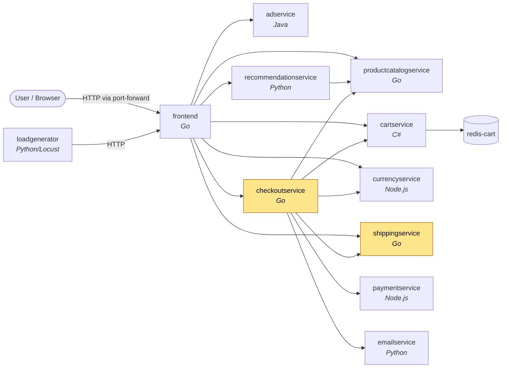
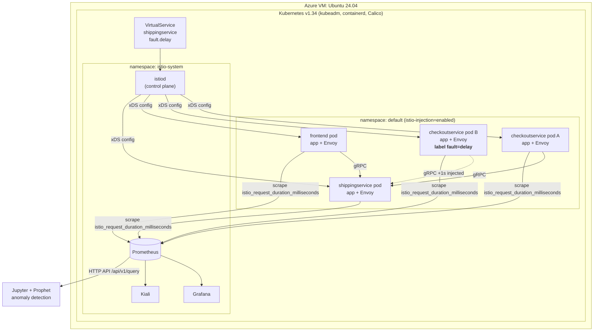

# Online Boutique on Kubernetes: Service Mesh, Observability & Fault Injection


I deployed Google's 11-service **[Online Boutique](https://github.com/GoogleCloudPlatform/microservices-demo)**
microservices app on a self-managed **Kubernetes** cluster on an **Azure VM** and put it inside
an **Istio** service mesh. I then used Istio to **inject latency faults**, first into one call
path and then into **a single pod** of a scaled-out service. To detect and isolate those faults
I used **Kiali**, **Prometheus** histogram queries and **Grafana** dashboards. The same metrics
are pulled over the Prometheus API into a **Prophet** time-series model for anomaly detection.

The labs come from *04-733 AIOps* (Carnegie Mellon University Africa, Fall 2026). The full lab
reports are in [`reports/`](reports/).

> **Status:** in progress. Kubernetes, Istio, Kiali, Prometheus and Grafana are done; the
> anomaly-detection / AIOps part is still being built (see [Roadmap](#roadmap)).

---

## Key results

| Experiment | What was measured | Result |
|---|---|---|
| Healthy baseline | p99 shipping latency, per caller | frontend **2 ms**, checkout **≈3–4.7 ms** |
| 1 s delay on the checkout → shipping path | p99 per caller | checkout **≈998 ms**, frontend **2 ms** (unchanged) |
| 1 s delay on **one of two** checkout pods | p99 per pod | delayed pod **999 ms**, healthy pod **≈8.3 ms** |
| Same fault, seen in Kiali (aggregate) | avg checkout → shipping | **≈500 ms**: the per-pod fault is averaged away |

**Main takeaway:** an aggregate dashboard can hide or blur a fault that affects only one
replica. Grouping metrics by the right label (`source_canonical_service` for call paths, `pod`
for replicas) and reading them from the **source** side lets you isolate it.

---

## Contents

- [Skills demonstrated](#skills-demonstrated)
- [Architecture](#architecture)
- [Environment](#environment)
- [Part 1: Kubernetes & Istio](#part-1-kubernetes--istio)
- [Part 2: Fault injection observed in Kiali](#part-2-fault-injection-observed-in-kiali)
- [Part 3: Measuring faults with Prometheus](#part-3-measuring-faults-with-prometheus)
- [Part 4: Grafana dashboards](#part-4-grafana-dashboards)
- [Part 5: Anomaly detection with Prophet (in progress)](#part-5-anomaly-detection-with-prophet-in-progress)
- [Lessons learned](#lessons-learned)
- [Reproduce it](#reproduce-it)
- [Repository layout](#repository-layout)
- [Roadmap](#roadmap)

---

## Skills demonstrated

| Area | What I did |
|---|---|
| **Kubernetes** | Single-node **kubeadm** cluster (containerd, **Calico** CNI) on Azure; deployed with **Kustomize**; `kubectl scale`; **rolling update** with a locally built image; live pod relabelling; resource requests/limits; `port-forward` access |
| **Istio service mesh** | `istioctl` install, Gateway API CRDs, automatic **Envoy sidecar injection**; `VirtualService` routing with **fault injection** matched by source workload and by **one pod's label** |
| **Observability** | **PromQL** on Istio histograms: `histogram_quantile`, `rate`, `sum by`, `[30m:1m]` subqueries; custom Envoy **histogram buckets**; Grafana **bar-gauge histograms** and **heatmaps**; Kiali traffic graphs and source/destination metrics |
| **AIOps / analysis** | Prometheus **HTTP API** → pandas → **Prophet** forecast, flagging points outside the 95% band as anomalies |
| **Communication** | Two written lab reports with annotated evidence ([`reports/`](reports/)) |

---

## Architecture

### Application call graph

Online Boutique is 11 polyglot microservices talking over gRPC. Every pod runs the app
container **plus an Envoy sidecar** (`2/2`), so every call below goes through the mesh and is
measured.



**shippingservice** has two callers: **frontend** (shipping quote on the cart page) and
**checkoutservice** (when an order is placed). The experiments slow down one caller and leave
the other alone, so the two paths can be compared.

The live Kiali traffic graph of the running cluster shows the same topology:


### Platform & observability stack



1. `istiod` pushes the `VirtualService` to every sidecar. The **client-side** Envoy in the
   labelled checkout pod holds each matching request for 1 s before sending it.
2. Every sidecar records request latency in the `istio_request_duration_milliseconds`
   histogram, which Prometheus scrapes.
3. Kiali and Grafana read from Prometheus. The Prophet notebook pulls the same data over the
   HTTP API.

---

## Environment

| Component | Version / detail |
|---|---|
| Host | Azure VM, Ubuntu 24.04 LTS |
| Kubernetes | v1.34, single node (control plane also runs workloads), **kubeadm** |
| Container runtime / CNI | containerd 2.x / **Calico** |
| Service mesh | Istio 1.30.4 + Gateway API CRDs v1.0.0 |
| Addons | Prometheus, Grafana, Kiali, Jaeger (`samples/addons`) |
| Application | Online Boutique v0.10.5 |

---

## Part 1: Kubernetes & Istio

**Cluster and mesh.** The course assumed a Docker Desktop cluster. I built a single-node
**kubeadm** cluster on an Azure VM instead, then installed Istio, the Gateway API CRDs and the
observability addons:

```bash
istioctl install
kubectl label namespace default istio-injection=enabled
kubectl apply --server-side -f https://github.com/kubernetes-sigs/gateway-api/releases/download/v1.0.0/standard-install.yaml
kubectl apply -f istio-1.30.4/samples/addons/
```


**Deploying the Boutique.** The app is deployed with Kustomize, with the `service-mesh-istio`
component enabled. Every pod comes up `2/2`: the app container plus the injected Envoy sidecar.

```bash
kubectl apply -k kustomize/
kubectl port-forward deployment/frontend 8080:8080
```

| Pods `2/2` (app + sidecar) | Deployments `1/1` + port-forward |
|---|---|
|  |  |


**Rolling update with a locally built image.** I rebuilt the frontend from source
(`docker build -t frontend .`), pointed `frontend.yaml` at `frontend:latest` and re-applied it.
Kubernetes started a new ReplicaSet and scaled the old one down to 0 while the site stayed up:


---

## Part 2: Fault injection observed in Kiali

### Baseline

Kiali's inbound metrics for the checkout → shipping path, reported from the **Source** side, with
no fault applied:


### Delay one call path (checkout → shipping)

[`istio-fault-injection/01-delay-checkout-to-shipping.yaml`](istio-fault-injection/01-delay-checkout-to-shipping.yaml)

```yaml
http:
- match:
  - sourceLabels:
      app: "checkoutservice"     # only calls FROM checkout
  fault:
    delay:
      fixedDelay: 1s
      percentage: { value: 100 }
  route:
  - destination: { host: shippingservice }
- route:                         # everyone else (frontend) is not delayed
  - destination: { host: shippingservice }
```

| Rule applied (`kubectl get vs -o yaml`) | Request duration jumps and flattens at the delayed level |
|---|---|
|  |  |

### Delay one pod of a scaled-out service

I scaled checkout to 2 replicas, labelled **one** pod, and matched on that label:

```bash
kubectl scale deploy checkoutservice --replicas=2
kubectl label pod <one-checkout-pod> fault=delay      # or: kubectl edit pod <id>
kubectl apply -f istio-fault-injection/02-delay-single-checkout-pod.yaml
```

```yaml
- match:
  - sourceLabels:
      app: "checkoutservice"
      fault: "delay"             # only the labelled replica
```

The Kubernetes `Service` spreads requests across both replicas, so half the calls are delayed by
1 s. **Kiali shows an average of about 500 ms** and can't tell which pod is slow. That gap is why
Part 3 uses Prometheus.


---

## Part 3: Measuring faults with Prometheus

All queries and explanations: [`promql/queries.md`](promql/queries.md).

> **Why `reporter="source"`?** Istio adds the delay in the *caller's* Envoy. The shipping pod's
> own sidecar (`reporter="destination"`) only times the work done inside shipping, so the
> injected delay never shows up there.

### p99 latency per caller, in one query

`sum by (le, source_canonical_service)` keeps the histogram buckets and a **separate series per
caller** in a single query:

```promql
histogram_quantile(0.99, sum by (le, source_canonical_service)
  (rate(istio_request_duration_milliseconds_bucket{
     destination_canonical_service="shippingservice",
     source_canonical_service=~"checkoutservice|frontend",
     reporter="source"}[5m])))
```

| Healthy: checkout ≈3–4.7 ms, frontend 2 ms | 1 s delay on checkout path: checkout ≈998 ms, frontend 2 ms |
|---|---|
|  |  |

<details>
<summary><b>Per-minute table view (<code>[30m:1m]</code> subquery): 30 values per caller</b></summary>

| | Healthy | Delayed |
|---|---|---|
| checkout |  |  |
| frontend |  |  |

</details>

### p99 latency per checkout pod

The metrics are reported by the source sidecar, so the `pod` label is the **calling** checkout
pod. Grouping `by (le, pod)` separates the two replicas:

```promql
histogram_quantile(0.99, sum by (le, pod)
  (rate(istio_request_duration_milliseconds_bucket{
     destination_canonical_service="shippingservice",
     source_canonical_service="checkoutservice",
     reporter="source"}[5m])))
```


| Graph: labelled pod `qhc9n` at 999 ms, `xq89n` near 0 | Table: 999 ms vs ≈8.3 ms |
|---|---|
|  |  |

Kiali reported a ~500 ms average for this fault. Prometheus shows that one replica is at 999 ms
and the other is healthy.

---

## Part 4: Grafana dashboards

Exported dashboard: [`grafana/shipping-latency-dashboard.json`](grafana/shipping-latency-dashboard.json)
(*Dashboards → New → Import*).

### Latency histogram (Bar gauge)

The query is the PromQL above without the `histogram_quantile()` wrapper, so Grafana gets the raw
bucket rates. The non-obvious settings are *Visualization = **Bar gauge***, *Format =
**Heatmap*** (which turns cumulative `le` buckets into per-bucket counts) and *Type =
**Instant***.

The resulting distribution is **bimodal**: undelayed calls pile up in the ~1 ms bucket and
delayed checkout calls sit in the 1000 ms / +Inf buckets.

| Histogram | Panel editor (query + settings) |
|---|---|
|  |  |

### Latency heatmap over time (extra credit)

A heatmap is the histogram turned on its side and repeated over time (*Visualization = Heatmap*,
*Type = Range*). With one checkout pod delayed there are **two bands**, one under 5 ms and one at
~1000 ms. Deleting the Istio rule removes the upper band.

| Delay applied: two bands | Delay removed: one band |
|---|---|
|  |  |

---

## Part 5: Anomaly detection with Prophet (in progress)

[`anomaly-detection/prophet_anomaly_detection.ipynb`](anomaly-detection/prophet_anomaly_detection.ipynb)

1. **Collect:** query the Prometheus **HTTP API** (`/api/v1/query`) for the p95 shipping latency
   over a `[1h:30s]` subquery and load the `[timestamp, value]` matrix into pandas.
2. **Train:** fit a **Prophet** model on a healthy baseline
   ([`shipping_responsetime.json`](anomaly-detection/shipping_responsetime.json), shown below).
3. **Detect:** predict over new data and flag every point above the 95% uncertainty interval
   (`y > yhat_upper`), such as a spike caused by injected faults.


---

## Lessons learned

| Problem | Cause | Fix / insight |
|---|---|---|
| Injected delay didn't appear in some metrics | The destination sidecar never sees a client-side delay | Use `reporter="source"` |
| Two callers or two pods blended into one line | Summing away the label that tells them apart | `sum by (le, source_canonical_service)` or `sum by (le, pod)` |
| Kiali showed ~500 ms, but no pod was actually at 500 ms | Averaging across replicas | Per-pod histograms in Prometheus/Grafana |
| Histograms couldn't tell ~1 ms from ~1000 ms | Bucket boundaries didn't match Istio's millisecond units | `sidecar.istio.io/statsHistogramBuckets` in **ms** (0.1 to 3000) on every Deployment |
| HTTP 500s after a few page views | Tight CPU/memory limits (e.g. cartservice) | Raised requests/limits in the manifests |
| Grafana showed a time series, not a histogram | Default panel options | Bar gauge + Format *Heatmap* + Type *Instant* |
| `istio-gateway` stuck at `PROGRAMMED=False` | No cloud LoadBalancer on a bare VM | Reach the app with `kubectl port-forward` |

---

## Reproduce it

```bash
# 0. Prereqs: a Kubernetes cluster + kubectl, istioctl 1.30.x
istioctl install -y
kubectl label namespace default istio-injection=enabled
kubectl apply --server-side -f https://github.com/kubernetes-sigs/gateway-api/releases/download/v1.0.0/standard-install.yaml
kubectl apply -f <istio-dir>/samples/addons/
kubectl get deploy -n istio-system                    # wait for all 1/1

# 1. Deploy the Boutique (Istio component + ms histogram buckets)
kubectl apply -k kustomize/
kubectl get pods                                      # wait for 2/2
kubectl port-forward deployment/frontend 8080:8080    # http://localhost:8080

# 2. Dashboards
istioctl dashboard kiali
istioctl dashboard prometheus
istioctl dashboard grafana

# 3. Fault: whole checkout -> shipping path
kubectl apply -f istio-fault-injection/01-delay-checkout-to-shipping.yaml

# 4. Fault: one checkout pod only
kubectl scale deploy checkoutservice --replicas=2
kubectl label pod <checkout-pod> fault=delay
kubectl apply -f istio-fault-injection/02-delay-single-checkout-pod.yaml

# Clean up
kubectl delete virtualservice shippingservice
kubectl scale deploy checkoutservice --replicas=1
```

---

## Repository layout

```
.
├── README.md
├── kustomize/                       ← Boutique manifests used on the cluster
│   ├── kustomization.yaml           ← service-mesh-istio component enabled
│   ├── base/*.yaml                  ← Deployments with ms histogram buckets + tuned resources
│   └── components/service-mesh-istio/
├── istio-fault-injection/           ← VirtualService delay rules (path-level, pod-level)
├── promql/queries.md                ← every PromQL query, with explanations
├── grafana/                         ← exported dashboard (bar gauge + heatmap)
├── anomaly-detection/               ← Prophet notebook + sample Prometheus API data
├── reports/                         ← full lab reports (PDF)
└── docs/images/                     ← screenshots used in this README
```

---

## Roadmap

- [x] Kubernetes cluster on Azure; Boutique deployed inside an Istio mesh
- [x] Rolling update with a locally built frontend image
- [x] Kiali service graph; Istio fault injection by caller and by single pod
- [x] Prometheus histogram queries; Grafana histogram + heatmap dashboards
- [ ] Prophet anomaly detection on live fault-injection runs (in progress)
- [ ] Richer frontend logging for LLM-agent-based incident analysis (AIOps)
- [ ] Prometheus alerting rules on the p99 latency queries
- [ ] Grafana dashboards provisioned as code (ConfigMap)

---

## Credits

- Application: [GoogleCloudPlatform/microservices-demo](https://github.com/GoogleCloudPlatform/microservices-demo) (Apache License 2.0)
- Course: 04-733 AIOps, Carnegie Mellon University Africa, Fall 2026

**Author:** Martin Koome
