# Online Boutique on Kubernetes: Service Mesh, Observability & Fault Injection


I deployed Google's 11-service **[Online Boutique](https://github.com/GoogleCloudPlatform/microservices-demo)**
microservices app on a self-managed **Kubernetes** cluster on an **Azure VM** and put it inside
an **Istio** service mesh. I then used Istio to **inject latency faults**, first into one call
path and then into **a single pod** of a scaled-out service. To detect and isolate those faults
I used **Kiali**, **Prometheus** histogram queries and **Grafana** dashboards. The same metrics
are pulled over the Prometheus API into **Prophet** time-series models. A containerised monitor
running in the cluster uses them to flag anomalies and incidents for every service and publishes
those flags back to Prometheus and Grafana.

The labs come from *04-733 AIOps* (Carnegie Mellon University Africa, Fall 2026). The full lab
reports are in [`reports/`](reports/).

> **Status:** in progress. Kubernetes, Istio, Kiali, Prometheus, Grafana and the Prophet
> anomaly/incident monitor are done; LLM-agent incident analysis is next (see [Roadmap](#roadmap)).

---

## Key results

| Experiment | What was measured | Result |
|---|---|---|
| Healthy baseline | p99 shipping latency, per caller | frontend **2 ms**, checkout **≈3–4.7 ms** |
| 1 s delay on the checkout → shipping path | p99 per caller | checkout **≈998 ms**, frontend **2 ms** (unchanged) |
| 1 s delay on **one of two** checkout pods | p99 per pod | delayed pod **999 ms**, healthy pod **≈8.3 ms** |
| Same fault, seen in Kiali (aggregate) | avg checkout → shipping | **≈500 ms**: the per-pod fault is averaged away |
| 500 ms delay on **productcatalogservice** (leaf) | p95 per service, Prophet monitor | productcatalog **2.9 → 495 ms**, recommendation **9.9 → ≈555 ms**, frontend **50 → ≈4,830 ms**, checkout **53 → ≈1,000–3,000 ms**; incidents raised for all four; shipping, currency, payment, email and ad unaffected |

**Main takeaway:** an aggregate dashboard can hide or blur a fault that affects only one
replica. Grouping metrics by the right label (`source_canonical_service` for call paths, `pod`
for replicas) and reading them from the **source** side lets you isolate it. A delay in a leaf
service spreads **up** the call graph: the per-service monitor flags every caller of the slow
service and none of the others, which points straight at the root cause.

---

## Contents

- [Skills demonstrated](#skills-demonstrated)
- [Architecture](#architecture)
- [Environment](#environment)
- [Part 1: Kubernetes & Istio](#part-1-kubernetes--istio)
- [Part 2: Fault injection observed in Kiali](#part-2-fault-injection-observed-in-kiali)
- [Part 3: Measuring faults with Prometheus](#part-3-measuring-faults-with-prometheus)
- [Part 4: Grafana dashboards](#part-4-grafana-dashboards)
- [Part 5: Anomaly detection with Prophet](#part-5-anomaly-detection-with-prophet)
- [Part 6: Anomaly & incident monitor in the cluster](#part-6-anomaly--incident-monitor-in-the-cluster)
- [Lessons learned](#lessons-learned)
- [Reproduce it](#reproduce-it)
- [Repository layout](#repository-layout)
- [Roadmap](#roadmap)

---

## Skills demonstrated

| Area | What I did |
|---|---|
| **Kubernetes** | Single-node **kubeadm** cluster (containerd, **Calico** CNI) on Azure; deployed with **Kustomize**; `kubectl scale`; **rolling update** with a locally built image; live pod relabelling; resource requests/limits; `port-forward` access |
| **Istio service mesh** | `istioctl` install, Gateway API CRDs, automatic **Envoy sidecar injection**; `VirtualService` routing with **fault injection** matched by source workload and by **one pod's label** |
| **Observability** | **PromQL** on Istio histograms: `histogram_quantile`, `rate`, `sum by`, `[30m:1m]` subqueries; custom Envoy **histogram buckets**; Grafana **bar-gauge histograms** and **heatmaps**; Kiali traffic graphs and source/destination metrics |
| **AIOps / analysis** | Prometheus **HTTP API** → pandas → **Prophet** (flat trend) per service; live anomaly check on single instant-query points; **incident = 4 consecutive anomalies**; flags published as a labelled Prometheus **Gauge** |
| **Containers** | Dockerfile with `dumb-init`; image built with Docker and imported into the cluster's **containerd** (`ctr -n k8s.io images import`); `imagePullPolicy: Never`; Prometheus **scrape annotations** on the pod template |
| **Communication** | Two written lab reports with annotated evidence ([`reports/`](reports/)) |

---

## Architecture

### Application call graph

Online Boutique is 11 polyglot microservices talking over gRPC. Every pod runs the app
container **plus an Envoy sidecar** (`2/2`), so every call below goes through the mesh and is
measured.


**shippingservice** has two callers: **frontend** (shipping quote on the cart page) and
**checkoutservice** (when an order is placed). The experiments slow down one caller and leave
the other alone, so the two paths can be compared.

The live Kiali traffic graph of the running cluster shows the same topology:

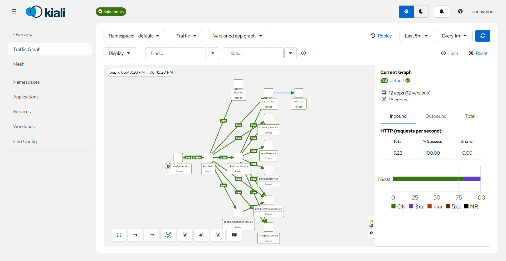

### Platform & observability stack

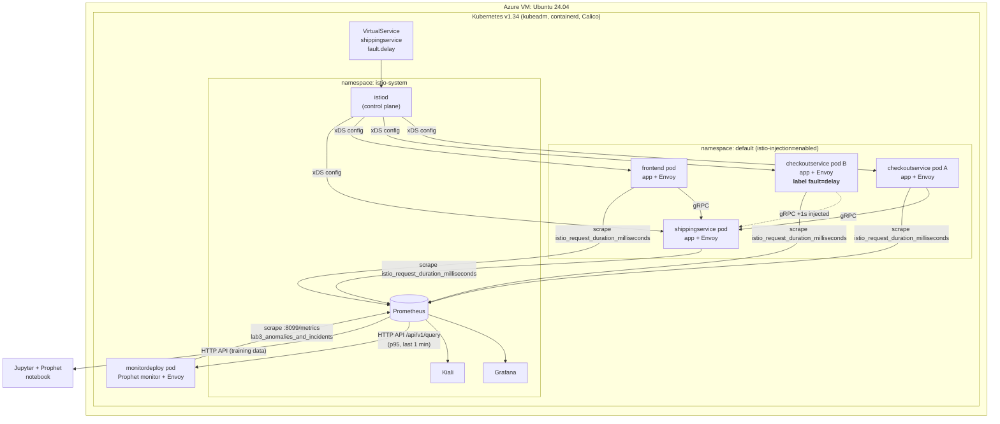

1. `istiod` pushes the `VirtualService` to every sidecar. The **client-side** Envoy in the
   labelled checkout pod holds each matching request for 1 s before sending it.
2. Every sidecar records request latency in the `istio_request_duration_milliseconds`
   histogram, which Prometheus scrapes.
3. Kiali and Grafana read from Prometheus. The Prophet notebook and the training script pull
   the same data over the HTTP API.
4. The **monitor pod** asks Prometheus for the latest p95 per service every minute, scores it
   with Prophet, and publishes `anomaly` / `incident` flags that Prometheus scrapes back.

---

## Environment

| Component | Version / detail |
|---|---|
| Host | Azure VM, Ubuntu 24.04 LTS |
| Kubernetes | v1.34, single node (control plane also runs workloads), **kubeadm** |
| Container runtime / CNI | containerd 2.x / **Calico** |
| Service mesh | Istio 1.30.4 + Gateway API CRDs v1.0.0 |
| Addons | Prometheus, Grafana, Kiali, Jaeger (`samples/addons`) |
| Application | Online Boutique v0.10.5 |

---

## Part 1: Kubernetes & Istio

**Cluster and mesh.** The course assumed a Docker Desktop cluster. I built a single-node
**kubeadm** cluster on an Azure VM instead, then installed Istio, the Gateway API CRDs and the
observability addons:

```bash
istioctl install
kubectl label namespace default istio-injection=enabled
kubectl apply --server-side -f https://github.com/kubernetes-sigs/gateway-api/releases/download/v1.0.0/standard-install.yaml
kubectl apply -f istio-1.30.4/samples/addons/
```

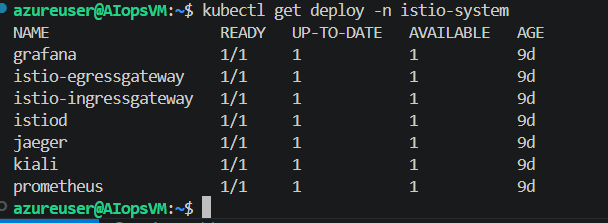

**Deploying the Boutique.** The app is deployed with Kustomize, with the `service-mesh-istio`
component enabled. Every pod comes up `2/2`: the app container plus the injected Envoy sidecar.

```bash
kubectl apply -k kustomize/
kubectl port-forward deployment/frontend 8080:8080
```

| Pods `2/2` (app + sidecar) | Deployments `1/1` + port-forward |
|---|---|
| 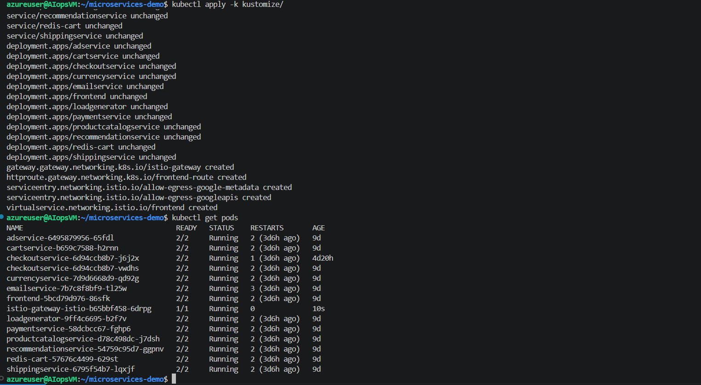 | 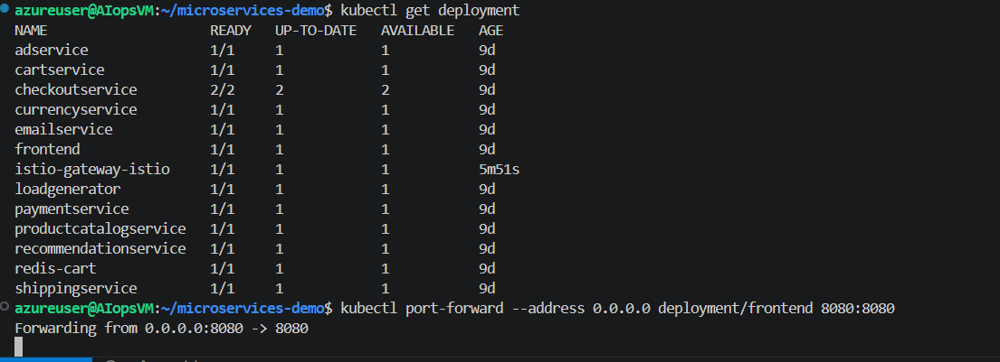 |

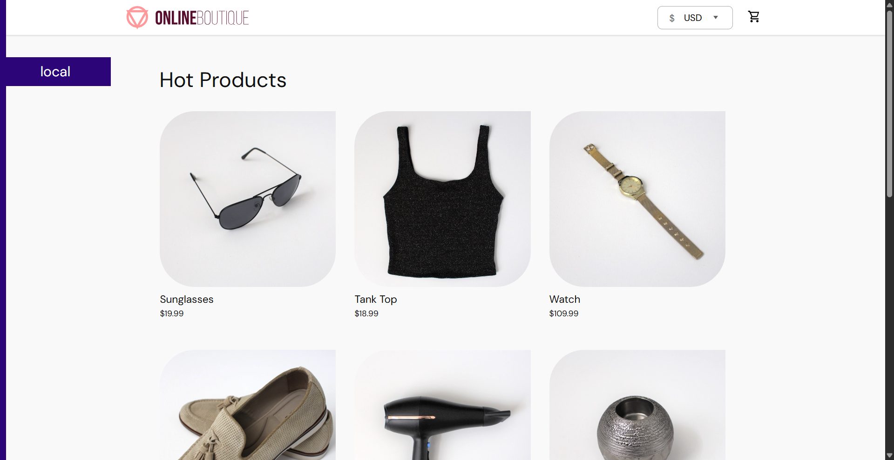

**Rolling update with a locally built image.** I rebuilt the frontend from source
(`docker build -t frontend .`), pointed `frontend.yaml` at `frontend:latest` and re-applied it.
Kubernetes started a new ReplicaSet and scaled the old one down to 0 while the site stayed up:

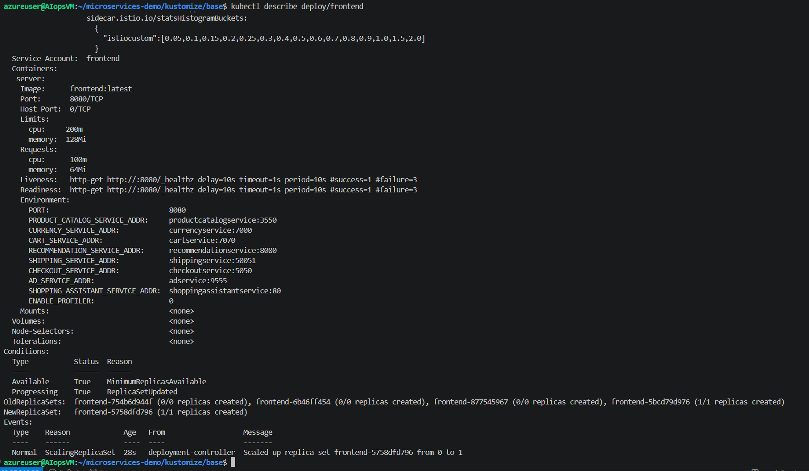

---

## Part 2: Fault injection observed in Kiali

### Baseline

Kiali's inbound metrics for the checkout → shipping path, reported from the **Source** side, with
no fault applied:

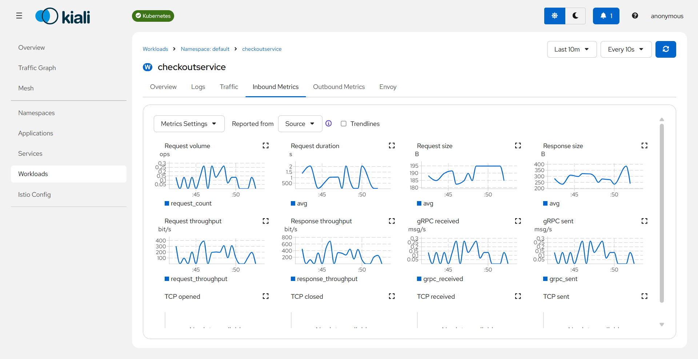

### Delay one call path (checkout → shipping)

[`istio-fault-injection/01-delay-checkout-to-shipping.yaml`](istio-fault-injection/01-delay-checkout-to-shipping.yaml)

```yaml
http:
- match:
  - sourceLabels:
      app: "checkoutservice"     # only calls FROM checkout
  fault:
    delay:
      fixedDelay: 1s
      percentage: { value: 100 }
  route:
  - destination: { host: shippingservice }
- route:                         # everyone else (frontend) is not delayed
  - destination: { host: shippingservice }
```

| Rule applied (`kubectl get vs -o yaml`) | Request duration jumps and flattens at the delayed level |
|---|---|
| 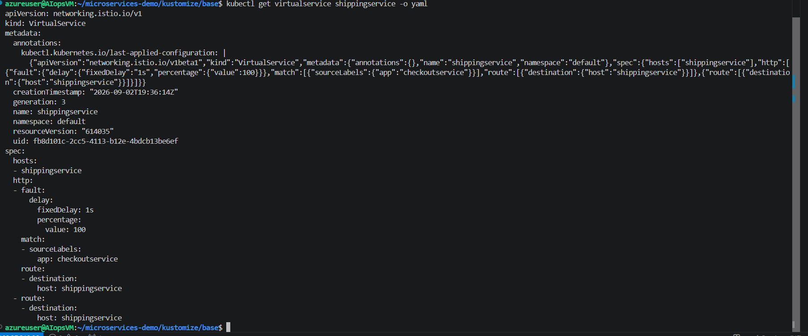 | 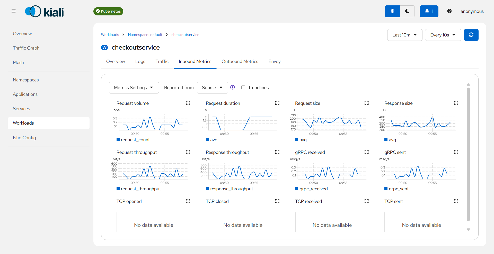 |

### Delay one pod of a scaled-out service

I scaled checkout to 2 replicas, labelled **one** pod, and matched on that label:

```bash
kubectl scale deploy checkoutservice --replicas=2
kubectl label pod <one-checkout-pod> fault=delay      # or: kubectl edit pod <id>
kubectl apply -f istio-fault-injection/02-delay-single-checkout-pod.yaml
```

```yaml
- match:
  - sourceLabels:
      app: "checkoutservice"
      fault: "delay"             # only the labelled replica
```

The Kubernetes `Service` spreads requests across both replicas, so half the calls are delayed by
1 s. **Kiali shows an average of about 500 ms** and can't tell which pod is slow. That gap is why
Part 3 uses Prometheus.

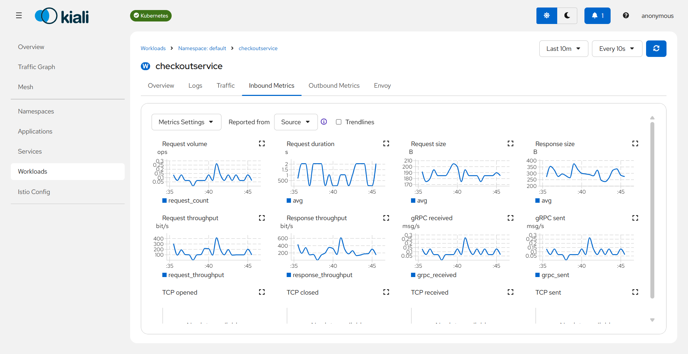

---

## Part 3: Measuring faults with Prometheus

All queries and explanations: [`promql/queries.md`](promql/queries.md).

> **Why `reporter="source"`?** Istio adds the delay in the *caller's* Envoy. The shipping pod's
> own sidecar (`reporter="destination"`) only times the work done inside shipping, so the
> injected delay never shows up there.

### p99 latency per caller, in one query

`sum by (le, source_canonical_service)` keeps the histogram buckets and a **separate series per
caller** in a single query:

```promql
histogram_quantile(0.99, sum by (le, source_canonical_service)
  (rate(istio_request_duration_milliseconds_bucket{
     destination_canonical_service="shippingservice",
     source_canonical_service=~"checkoutservice|frontend",
     reporter="source"}[5m])))
```

| Healthy: checkout ≈3–4.7 ms, frontend 2 ms | 1 s delay on checkout path: checkout ≈998 ms, frontend 2 ms |
|---|---|
| 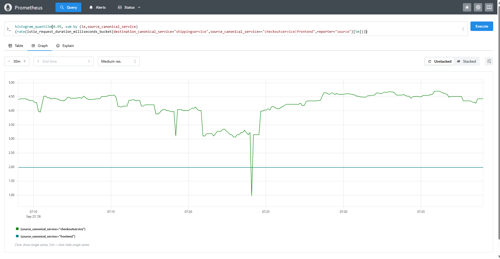 | 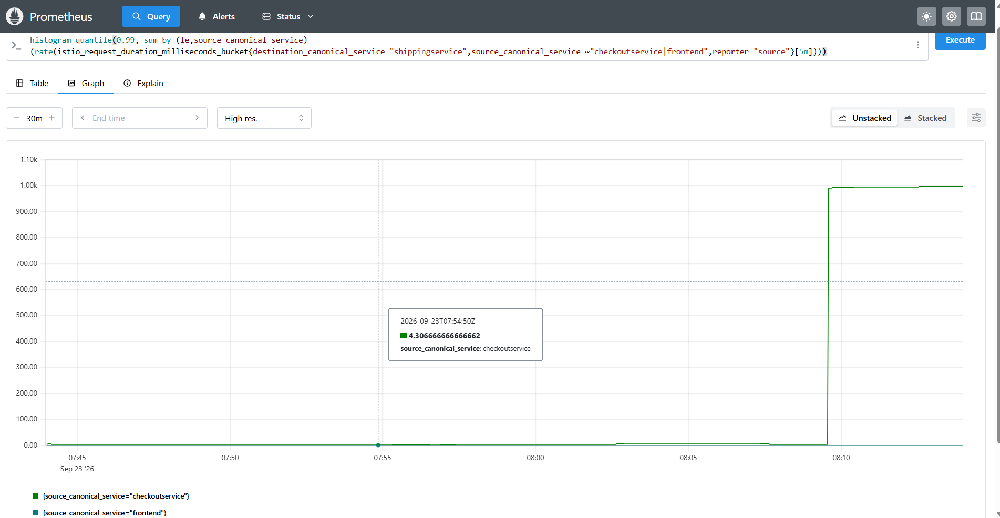 |

<details>
<summary><b>Per-minute table view (<code>[30m:1m]</code> subquery): 30 values per caller</b></summary>

| | Healthy | Delayed |
|---|---|---|
| checkout | 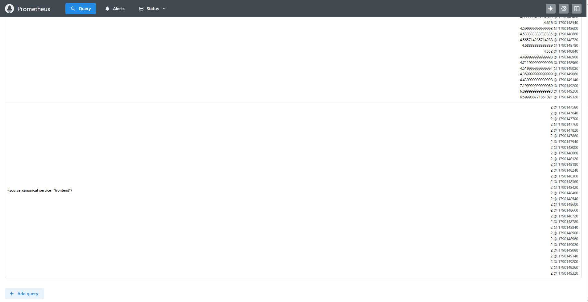 | 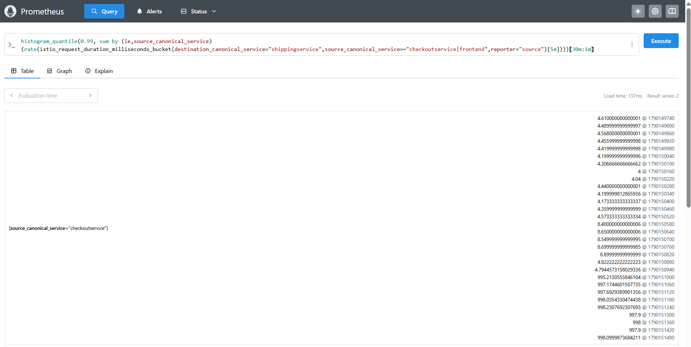 |
| frontend | 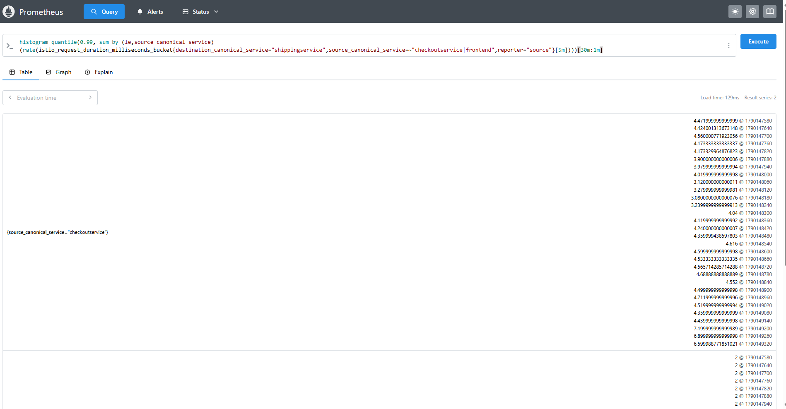 | 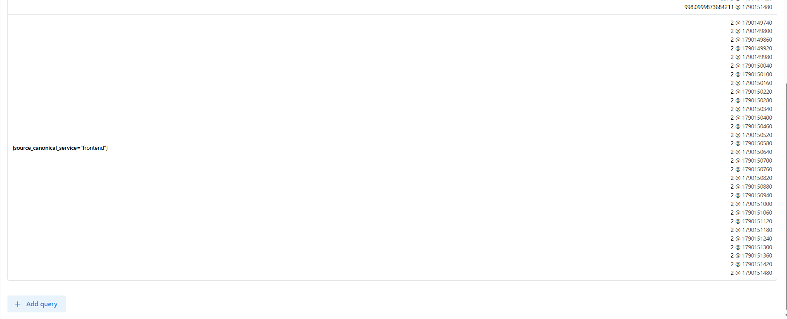 |

</details>

### p99 latency per checkout pod

The metrics are reported by the source sidecar, so the `pod` label is the **calling** checkout
pod. Grouping `by (le, pod)` separates the two replicas:

```promql
histogram_quantile(0.99, sum by (le, pod)
  (rate(istio_request_duration_milliseconds_bucket{
     destination_canonical_service="shippingservice",
     source_canonical_service="checkoutservice",
     reporter="source"}[5m])))
```

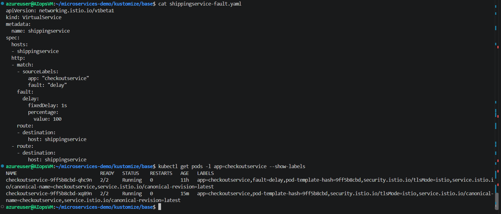

| Graph: labelled pod `qhc9n` at 999 ms, `xq89n` near 0 | Table: 999 ms vs ≈8.3 ms |
|---|---|
| 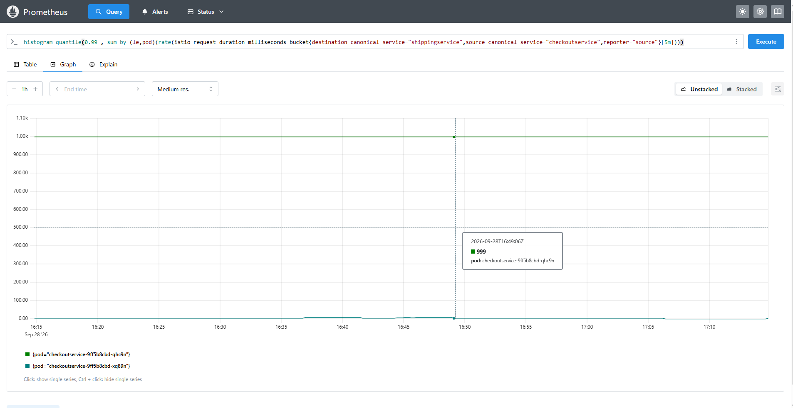 | 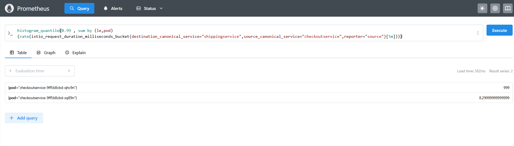 |

Kiali reported a ~500 ms average for this fault. Prometheus shows that one replica is at 999 ms
and the other is healthy.

---

## Part 4: Grafana dashboards

Exported dashboard: [`grafana/shipping-latency-dashboard.json`](grafana/shipping-latency-dashboard.json)
(*Dashboards → New → Import*).

### Latency histogram (Bar gauge)

The query is the PromQL above without the `histogram_quantile()` wrapper, so Grafana gets the raw
bucket rates. The non-obvious settings are *Visualization = **Bar gauge***, *Format =
**Heatmap*** (which turns cumulative `le` buckets into per-bucket counts) and *Type =
**Instant***.

The resulting distribution is **bimodal**: undelayed calls pile up in the ~1 ms bucket and
delayed checkout calls sit in the 1000 ms / +Inf buckets.

| Histogram | Panel editor (query + settings) |
|---|---|
| 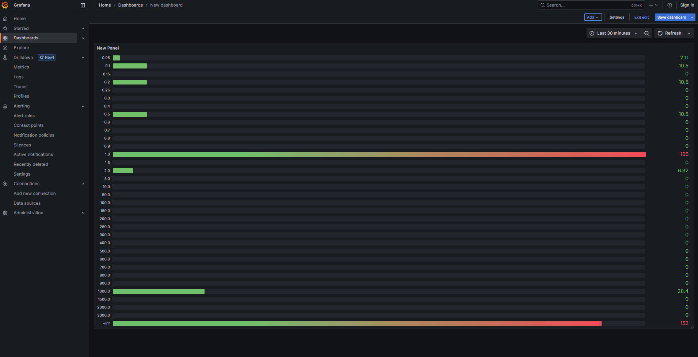 | 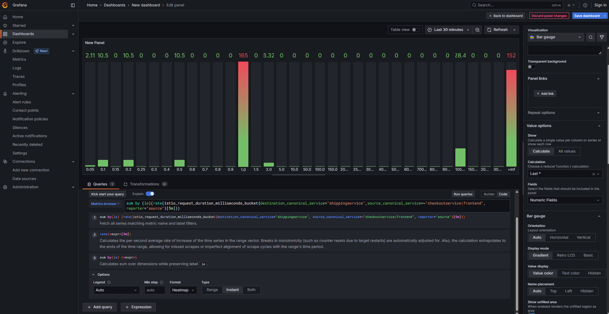 |

### Latency heatmap over time (extra credit)

A heatmap is the histogram turned on its side and repeated over time (*Visualization = Heatmap*,
*Type = Range*). With one checkout pod delayed there are **two bands**, one under 5 ms and one at
~1000 ms. Deleting the Istio rule removes the upper band.

| Delay applied: two bands | Delay removed: one band |
|---|---|
| 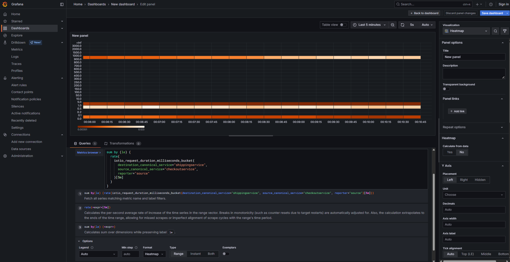 | 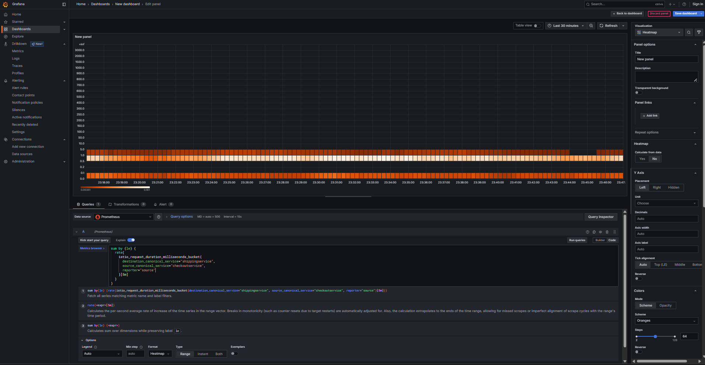 |

---

## Part 5: Anomaly detection with Prophet

[`anomaly-detection/prophet_anomaly_detection.ipynb`](anomaly-detection/prophet_anomaly_detection.ipynb)

1. **Collect:** query the Prometheus **HTTP API** for the p95 shipping latency over a
   `[12h:30s]` subquery and load the `[timestamp, value]` matrix into pandas.
2. **Train:** fit a **Prophet** model on a healthy baseline
   ([`shipping_responsetime.json`](anomaly-detection/shipping_responsetime.json), shown below).
   `growth='flat'` with all seasonality off gives a fixed flat trend, so the model can forecast
   far into the future.
3. **Detect:** run an *instant* query (no `[x:y]` subquery) to get a single value, wrap it in a
   1-record dataframe, predict, and flag it when it is above the 95% interval (`y > yhat_upper`).

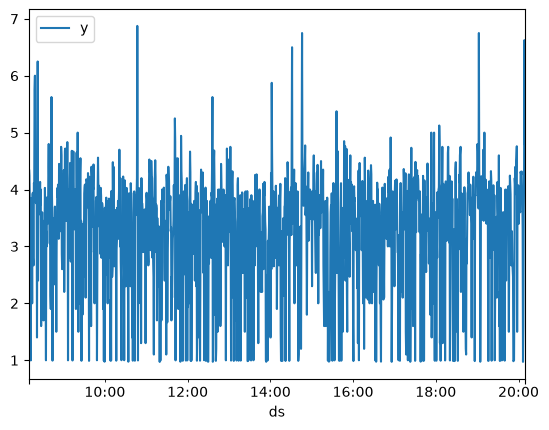

### Single-service monitor

[`anomaly-detection/monitor.py`](anomaly-detection/monitor.py) turns the notebook into a loop
that runs every 60 s:

```promql
histogram_quantile( 0.95, sum by (le) (increase(istio_request_duration_milliseconds_bucket{
    destination_canonical_service='shippingservice', reporter='source'}[1m])))
```

- Each cycle adds one row (`ds, y, yhat, yhat_lower, yhat_upper, anomaly, incident`) to a
  dataframe and prints it.
- **Incident** = the last **4** entries are all anomalies. A single slow minute raises `anomaly`
  but not `incident`, and one normal minute clears the incident.
- Both values are published as one Prometheus gauge with labels:

```python
g = Gauge('lab3_anomalies_and_incidents',
          'Gauge for tracking anomalies and incidents across all services',
          ["service", "kind"])
g.labels(service_name, "anomaly").set(anomaly_count)          # 0 or 1
g.labels(service_name, "incident").set(1 if anomaly_last4_count == 4 else 0)
```

Run it locally with `PROMETHEUS_URL=http://localhost:9090 python monitor.py` (the default is the
in-cluster name `http://prometheus.istio-system:9090`).

---

## Part 6: Anomaly & incident monitor in the cluster

### Deploying the monitor

| File | Purpose |
|---|---|
| [`Dockerfile`](anomaly-detection/Dockerfile) / [`monitor_deploy.yaml`](anomaly-detection/monitor_deploy.yaml) | Single-service (shipping) monitor |
| [`Dockerfile.all`](anomaly-detection/Dockerfile.all) / [`monitor_all_deploy.yaml`](anomaly-detection/monitor_all_deploy.yaml) | All-services monitor (the one running now) |
| [`requirements.txt`](anomaly-detection/requirements.txt) | Pinned Prophet / pandas / prometheus_client versions |

The training data is copied into the image, so the models are trained at startup. The pod
template carries the Prometheus scrape annotations; Istio's metrics merging then serves the
monitor's metrics through the sidecar (port 15020), and the pod runs `2/2` like every Boutique
service.

```yaml
  template:
    metadata:
      labels:
        app: monitor
      annotations:
        prometheus.io/scrape: "true"
        prometheus.io/port: "8099"
        prometheus.io/path: "/metrics"
        proxy.istio.io/config: '{ "holdApplicationUntilProxyStarts": true }'
```

The cluster runs on **containerd**, which can't see images built by Docker, so the image is
imported before deploying:

```bash
cd anomaly-detection
docker build -f Dockerfile.all -t monitor-all:latest .
docker save monitor-all:latest | sudo ctr -n k8s.io images import --platform linux/amd64 -
kubectl apply -f monitor_all_deploy.yaml
kubectl logs -f deploy/monitordeploy -c monitorcontainer
```

### Monitoring every service

- [`fetch_training_data.py`](anomaly-detection/fetch_training_data.py) pulls 24 h of p95 history
  for all 10 HTTP/gRPC services into
  [`training_data/`](anomaly-detection/training_data/). The window is chosen to end **before**
  any fault injection (`--end "2026-10-15 12:00"`), so the models learn only normal behaviour.
  (`redis-cart` speaks plain TCP and has no request-duration histogram.)
- [`monitor_all.py`](anomaly-detection/monitor_all.py) trains one Prophet model per service. Each
  cycle, a single instant query grouped `by (le, destination_canonical_service)` returns the
  latest p95 for every service at once. Every service has its own anomaly history and its own
  `service` label on the gauge, and the console prints one summary table:

```
=== 2026-10-15 14:18:56  anomalies=5  incidents=3 ['frontend', 'productcatalogservice', 'recommendationservice'] ===
                             y   yhat  yhat_upper  anomaly  last4  incident
service
adservice                 4.24   4.17        5.03        0      0         0
cartservice               6.35   5.07        6.24        1      1         0
checkoutservice        1925.00  52.58       88.35        1      2         0
currencyservice           4.24   4.01        4.46        0      0         0
emailservice              4.70   5.13       11.17        0      0         0
frontend               4832.55  49.55       57.09        1      4         1
paymentservice            0.98   3.80        8.32        0      0         0
productcatalogservice   495.23   2.85        3.80        1      4         1
recommendationservice   556.67   9.90       14.55        1      4         1
shippingservice           3.80   3.37        5.35        0      0         0
```

### Fault in a leaf service spreads up the call graph

[`istio-fault-injection/03-delay-productcatalog.yaml`](istio-fault-injection/03-delay-productcatalog.yaml)
adds 500 ms to **every** call to productcatalogservice. Within about 5 minutes, incidents were
raised for productcatalog itself and for all of its callers. Frontend reached ~4.8 s because a
single page load calls productcatalog many times:

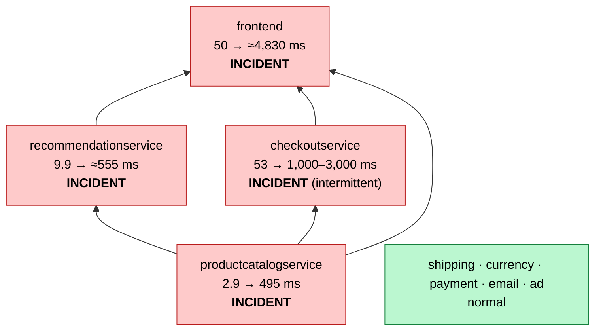

Checkout's incident flickered: with pages taking ~5 s, the load generator completed so few orders
that some minutes had **no checkout requests at all** (`NaN` p95). A minute with no data is
counted as "not an anomaly", which breaks the 4-in-a-row streak.

### Grafana

Two exported dashboards (*Dashboards → New → Import*):

- [`grafana/lab3-anomaly-monitor-dashboard.json`](grafana/lab3-anomaly-monitor-dashboard.json):
  shipping response-time heatmap, p95 time series, and anomaly / incident flags as time series
  plus gauges.
- [`grafana/lab3-all-services-dashboard.json`](grafana/lab3-all-services-dashboard.json):
  summary state timelines and a table of anomaly / incident flags for **all** services, every
  service's p95 on one log-scale chart, and detail rows (heatmap, p95, flags) for shipping,
  checkout and frontend.

---

## Lessons learned

| Problem | Cause | Fix / insight |
|---|---|---|
| Injected delay didn't appear in some metrics | The destination sidecar never sees a client-side delay | Use `reporter="source"` |
| Two callers or two pods blended into one line | Summing away the label that tells them apart | `sum by (le, source_canonical_service)` or `sum by (le, pod)` |
| Kiali showed ~500 ms, but no pod was actually at 500 ms | Averaging across replicas | Per-pod histograms in Prometheus/Grafana |
| Histograms couldn't tell ~1 ms from ~1000 ms | Bucket boundaries didn't match Istio's millisecond units | `sidecar.istio.io/statsHistogramBuckets` in **ms** (0.1 to 3000) on every Deployment |
| HTTP 500s after a few page views | Tight CPU/memory limits (e.g. cartservice) | Raised requests/limits in the manifests |
| Grafana showed a time series, not a histogram | Default panel options | Bar gauge + Format *Heatmap* + Type *Instant* |
| `istio-gateway` stuck at `PROGRAMMED=False` | No cloud LoadBalancer on a bare VM | Reach the app with `kubectl port-forward` |
| Locally built monitor image not found by the pod | Docker's image store is separate from the containerd `k8s.io` namespace that Kubernetes uses | `docker save … \| sudo ctr -n k8s.io images import -` and `imagePullPolicy: Never` |
| Training on "the last 12 h" would have learned the faults | Fault-injection runs were inside the window | Train on a fixed window that ends before any fault (`fetch_training_data.py --end`) |
| Burst of anomalies right after redeploying the monitor | Image import and training 10 models on a 4-CPU node slowed the whole app for a minute | Real transient; the 4-in-a-row incident rule filters it out |
| Checkout incident kept dropping during the productcatalog fault | Some minutes had no checkout requests, so p95 was `NaN` and counted as normal | Expected with low-traffic services; skipping empty minutes would keep the streak |
| No output in `kubectl logs` | Python buffers stdout when it isn't a terminal | `print(..., flush=True)` and `PYTHONUNBUFFERED=1` |

---

## Reproduce it

```bash
# 0. Prereqs: a Kubernetes cluster + kubectl, istioctl 1.30.x
istioctl install -y
kubectl label namespace default istio-injection=enabled
kubectl apply --server-side -f https://github.com/kubernetes-sigs/gateway-api/releases/download/v1.0.0/standard-install.yaml
kubectl apply -f <istio-dir>/samples/addons/
kubectl get deploy -n istio-system                    # wait for all 1/1

# 1. Deploy the Boutique (Istio component + ms histogram buckets)
kubectl apply -k kustomize/
kubectl get pods                                      # wait for 2/2
kubectl port-forward deployment/frontend 8080:8080    # http://localhost:8080

# 2. Dashboards
istioctl dashboard kiali
istioctl dashboard prometheus
istioctl dashboard grafana

# 3. Fault: whole checkout -> shipping path
kubectl apply -f istio-fault-injection/01-delay-checkout-to-shipping.yaml

# 4. Fault: one checkout pod only
kubectl scale deploy checkoutservice --replicas=2
kubectl label pod <checkout-pod> fault=delay
kubectl apply -f istio-fault-injection/02-delay-single-checkout-pod.yaml

# 5. Anomaly / incident monitor for all services
cd anomaly-detection
python fetch_training_data.py --end "YYYY-MM-DD HH:MM"   # end before any fault injection
docker build -f Dockerfile.all -t monitor-all:latest .
docker save monitor-all:latest | sudo ctr -n k8s.io images import --platform linux/amd64 -
kubectl apply -f monitor_all_deploy.yaml
kubectl logs -f deploy/monitordeploy -c monitorcontainer
cd ..

# 6. Fault: leaf service (all callers of productcatalog)
kubectl apply -f istio-fault-injection/03-delay-productcatalog.yaml

# Clean up
kubectl delete virtualservice shippingservice productcatalogservice
kubectl scale deploy checkoutservice --replicas=1
```

---

## Repository layout

```
.
├── README.md
├── kustomize/                       ← Boutique manifests used on the cluster
│   ├── kustomization.yaml           ← service-mesh-istio component enabled
│   ├── base/*.yaml                  ← Deployments with ms histogram buckets + tuned resources
│   └── components/service-mesh-istio/
├── istio-fault-injection/           ← VirtualService delay rules (path, pod, leaf service)
├── promql/queries.md                ← every PromQL query, with explanations
├── grafana/                         ← exported dashboards (histograms, anomaly monitors)
├── anomaly-detection/
│   ├── prophet_anomaly_detection.ipynb
│   ├── monitor.py                   ← single-service monitor (shipping)
│   ├── monitor_all.py               ← all-services monitor
│   ├── fetch_training_data.py       ← pulls training data for every service
│   ├── training_data/               ← 24 h healthy p95 per service
│   ├── Dockerfile, Dockerfile.all, requirements.txt
│   └── monitor_deploy.yaml, monitor_all_deploy.yaml
├── reports/                         ← full lab reports (PDF)
└── docs/images/                     ← screenshots used in this README
```

---

## Roadmap

- [x] Kubernetes cluster on Azure; Boutique deployed inside an Istio mesh
- [x] Rolling update with a locally built frontend image
- [x] Kiali service graph; Istio fault injection by caller and by single pod
- [x] Prometheus histogram queries; Grafana histogram + heatmap dashboards
- [x] Prophet anomaly detection, single service then all services
- [x] Monitor deployed in the cluster; anomaly / incident gauges in Prometheus and Grafana
- [x] Leaf-service fault traced up the call graph by the monitor
- [ ] LLM agents that investigate when an `incident` flag is raised (AIOps)
- [ ] Richer frontend logging for LLM-agent-based incident analysis
- [ ] Prometheus alerting rules on the p99 latency queries
- [ ] Grafana dashboards provisioned as code (ConfigMap)

---

## Credits

- Application: [GoogleCloudPlatform/microservices-demo](https://github.com/GoogleCloudPlatform/microservices-demo) (Apache License 2.0)
- Course: 04-733 AIOps, Carnegie Mellon University Africa, Fall 2026

**Author:** Martin Koome
